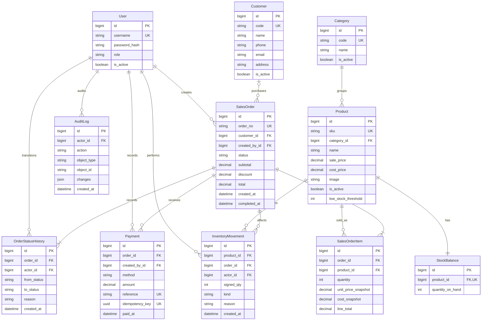

# Smart Sales — mô hình dữ liệu MVP

`SalesOrderItem(order_id, product_id)` là duy nhất. `InventoryMovement(order_id, product_id, kind)` là duy nhất khi có đơn hàng; một đơn chỉ xuất và hoàn tồn mỗi sản phẩm một lần. Mã tham chiếu thanh toán có thể để trống; mã chống gửi trùng luôn bắt buộc trong service.

Tất cả số tiền là `Decimal(16, 0)` tính bằng VND. Tổng đơn phải bằng tổng tiền hàng trừ chiết khấu; giá dòng hàng phải bằng số lượng nhân giá snapshot. Các tham chiếu chứng từ dùng `PROTECT` để tránh mất lịch sử. Lưu trữ sản phẩm, danh mục và khách hàng dùng trạng thái hoạt động.
